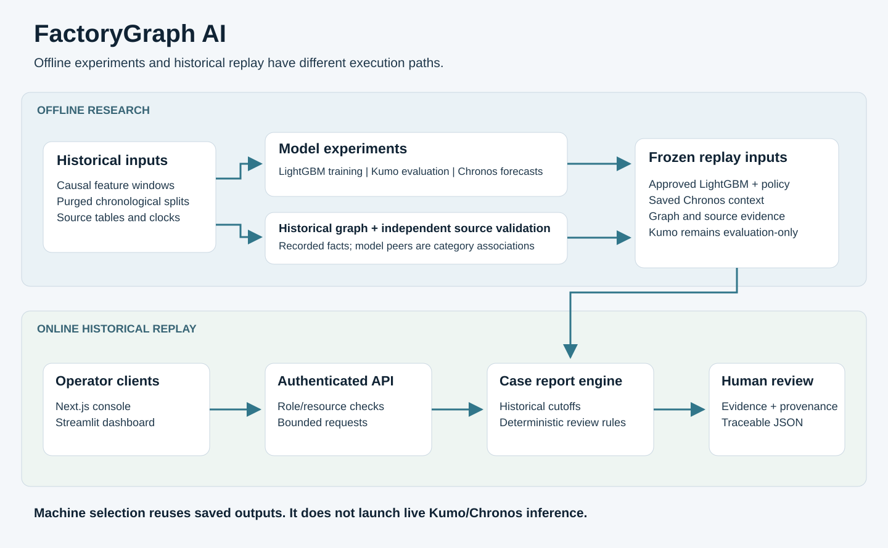
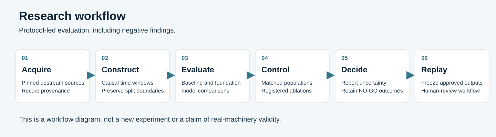
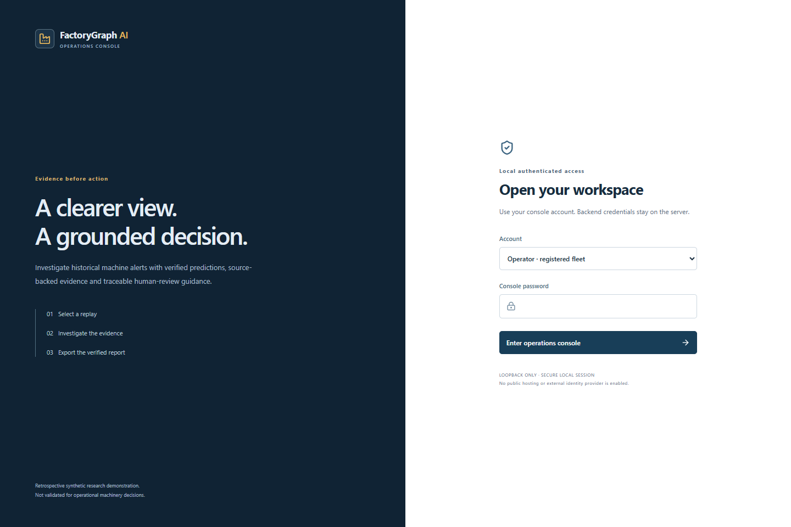
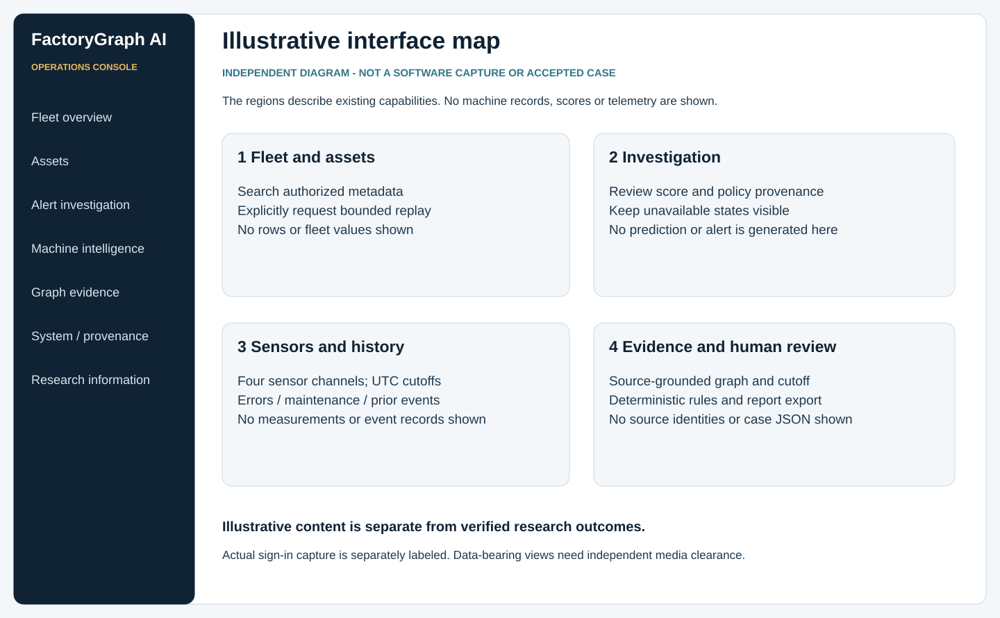

<p align="center"></p>

# FactoryGraph AI — Evidence-Grounded Industrial Predictive Maintenance

**An end-to-end industrial AI research platform combining predictive ML, foundation-model evaluation, historical knowledge graphs and a full-stack operations console.**

FactoryGraph helps an engineer investigate historical machine risk: read a calibrated
score, inspect sensor history, trace the supporting records and review deterministic
suggestions. The repository includes the experiment pipeline and authenticated application.

**Verified native application. Source showcase; no hosted live service.** Research uses
synthetic historical industrial data and is not validated for machinery decisions.
Container execution, public deployment and MetroPT-3 full testing remain incomplete.
Accepted model/data artifacts and genuine saved gallery cases are not bundled.

[Setup and testing](PUBLIC_REPRODUCIBILITY.md) · [Architecture](docs/ARCHITECTURE.md) ·
[Results](docs/public_results/) · [Data and models](docs/DATA_AND_MODELS.md) ·
[Security scope](SECURITY.md)

## What is implemented

- **Calibrated 24-hour LightGBM risk:** causal features, chronological/purged splits,
  probability calibration and frozen alert policies.
- **NVIDIA Kumo Tabular benchmark:** genuine pretrained comparison using bounded
  historical context; no substitute neural model or task-specific neural training.
- **Amazon Chronos-2 forecasts:** sensor forecasts and matured residual features,
  separately identified as supplementary saved context in the serving workflow.
- **Neo4j historical graph:** bounded source-validated queries and provenance;
  category peers are distinct from physical equipment dependencies.
- **Evidence-grounded decision support:** deterministic human-review rules, supporting
  evidence IDs, explicit unavailable states and traceable JSON reports.
- **FastAPI and Streamlit:** authenticated, authorized, bounded native API and dashboard.
- **Next.js Operations Console v2:** fleet overview, machine investigation, sensor charts,
  source graph exploration, human-review reports and system provenance.
- **Native optimization:** matched evaluation of optional C1 metadata indexing; default B retained.

## Offline research and online historical replay



[Editable diagram and execution boundaries](docs/ARCHITECTURE.md).


Machine selection does **not** perform live Kumo/Chronos inference or model training.
The approved predictor remains Phase 1 LightGBM / exact A0: threshold
**0.9996602309282403**, **24-hour cooldown**. Fusion replacement remains **NO-GO**.

## Accepted findings

| Finding | Scope |
|---|---|
| **100 synthetic machines** | Microsoft historical predictive-maintenance sample |
| **LightGBM AP 0.995464** | 72,633 accepted test snapshots; ranking metric |
| **141 / 171 eligible failure events detected** | Frozen validation-selected 1% row-budget policy; 669 test alert rows |
| **8,092 Neo4j nodes / 25,243 relationships** | Accepted historical graph, no causal/physical-dependency claim |
| **Chronos-2 MASE 0.72295** | Macro test MASE, four sensors, 24h horizon, 9,200 daily origins |
| **Fusion replacement NO-GO** | A6 did not meet the preregistered paired event-recall criterion |
| **C1 fleet replay improvement 41.03%** | Median matched paired native latency reduction; optional C1 |
| **174 accepted Python tests** | Provisioned genuine integration scope, not an artifact-free clone count |

[Sanitized public summaries](docs/public_results/) retain selected actual metrics and
source report digests. They are not full original records or a new experiment. This
previously observed synthetic test is not a fresh confirmatory holdout, real-industrial
validation, production false-alarm guarantee or proof of causal diagnosis.

## Research workflow



## Console preview



Actual application, empty credentials, no private research input. Fleet, investigation,
sensor, graph and review screenshots are withheld because their source-derived records
have not been cleared for redistribution. No mockup is presented as a verified case.



The capability map is independently authored, illustrative information only. The sign-in
image is a genuine software capture. Neither contains source-derived records or invented
research outcomes. [Media types and restrictions](docs/MEDIA.md).

## Run from a source checkout

Verified target: Windows, Python 3.12.10, Node 24.19.x. Linux/macOS and containers have
not passed acceptance.

```powershell
py -3.12 -m venv .venv
.\.venv\Scripts\python.exe -m pip install -r requirements.lock
.\.venv\Scripts\python.exe -m pip install --no-deps --no-build-isolation -e .
.\.venv\Scripts\python.exe -m pip check
.\.venv\Scripts\python.exe -m pytest -q
$env:NEXT_TELEMETRY_DISABLED = '1'
npm.cmd --prefix apps/factorygraph_console ci --ignore-scripts
npm.cmd --prefix apps/factorygraph_console run typecheck
npm.cmd --prefix apps/factorygraph_console test
npm.cmd --prefix apps/factorygraph_console run build
```

These commands build source and run independent software tests. They do not provision
the full historical prediction engine. See [public-source validation](docs/VALIDATION.md).

| Workflow | Public behavior and prerequisites |
|---|---|
| Source/static inspection | Full Python/TypeScript, schemas, protocols, locks and diagrams included |
| Artifact-free tests | Independent software fixtures, no accepted benchmark data |
| Illustrative fixture | tests/fixtures/illustrative_case.json; unscored, no source facts or accepted provenance; not an interactive demo |
| Genuine gallery | Real gallery code retained; authorized saved cases and manifest must be supplied separately |
| Full native app | Accepted frozen predictions/model identity/policy, source tables, saved temporal context, registrations and Neo4j |
| Docker | Prepared configuration; actual execution/security/resource acceptance unverified |

No private bundle is silently acquired. Full-mode failures never select illustrative
test data. [Reproduction instructions](PUBLIC_REPRODUCIBILITY.md) explain independent
baseline acquisition, API software tests and separately provisioned genuine integration.

## Stack and source

Python · LightGBM · Pandas · NumPy · PyArrow · PyTorch · Kumo · Chronos-2 · Neo4j ·
FastAPI · Streamlit · Next.js · TypeScript · Tailwind · Recharts · Radix · TanStack ·
pytest · HTTPX · Playwright · Node test runner.

| Location | Purpose |
|---|---|
| src/factorygraph/ | Baseline, genuine model adapters and Phase 2–8 implementation |
| apps/factorygraph_console/ | Next.js, BFF, contracts, charts, graph and review UI |
| apps/factorygraph_dashboard/ | Original Streamlit application/client |
| configs/ and requirements/ | Schemas, registered settings and isolated dependency locks |
| tests/ and scripts/ | Software tests and separately provisioned native workflows |
| docs/public_results/ | Sanitized aggregate accepted results |
| deployment/ | Unexecuted Docker/Compose configuration |

The complete product is source-checkout based. The Python wheel contains Python modules,
not Next.js, data or a full deployment. The sdist includes JSON contracts/configuration;
see [the deliberate packaging scope](PACKAGING.md).


