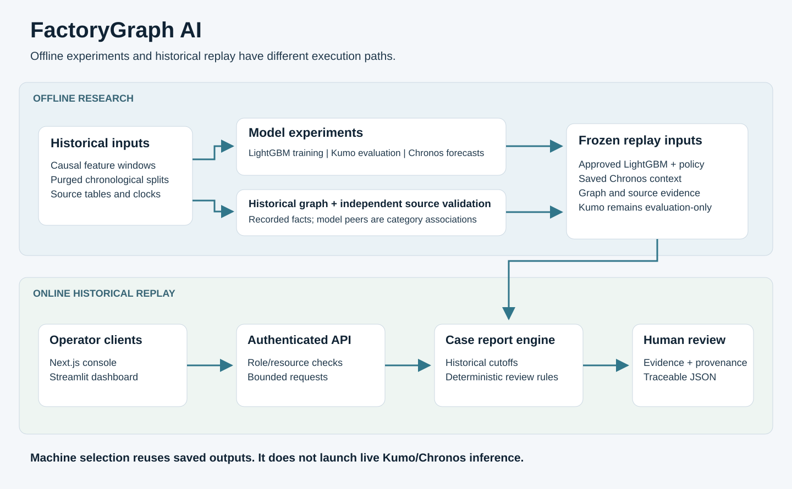
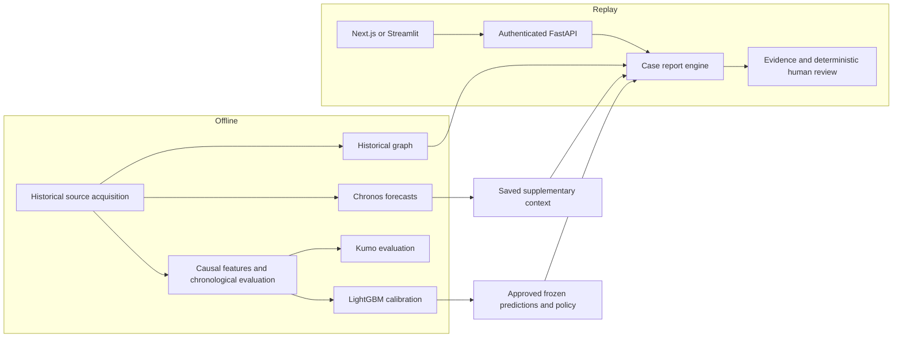
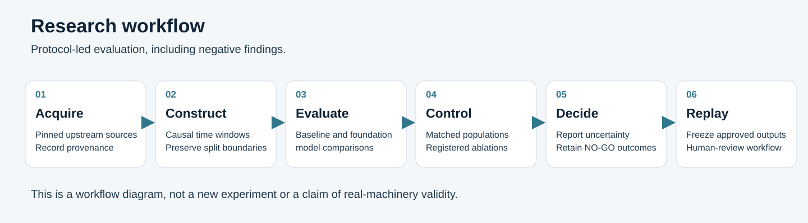

# Architecture and execution boundaries

Offline training/evaluation produces frozen accepted outputs. Online historical replay
uses the approved LightGBM/policy, saved supplementary Chronos context and historical
source-validated graph evidence. It does not perform live Kumo/Chronos inference on
a machine selection. Kumo remains an offline benchmark.

The [interface map](media/console-overview-illustrative.svg) is illustrative; the
[media inventory](MEDIA.md) distinguishes it from actual software captures.
