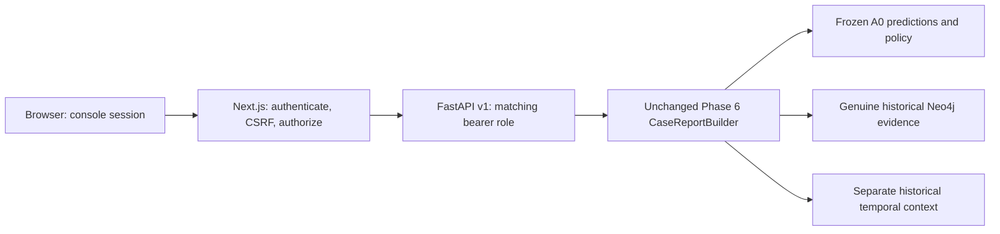

# Operations Console v2 — architecture

The new application is `apps/factorygraph_console/`: Next.js App Router, React/TypeScript,
Tailwind tokens, local shadcn-style reusable components on Radix primitives, TanStack
Table v9 and Recharts. It is additive. The accepted Streamlit application and every
Python research/serving module remain unchanged. No new model or scientific phase exists.

The browser knows only its opaque HttpOnly local session and a session-bound CSRF nonce.
`lib/server/` is server-only and reads backend credential files at runtime. It accepts
only explicit typed resources, validates parameters, enforces viewer Machine 17/operator
metrics scope, then forwards with the matching backend role. FastAPI authorization remains
independent. There is no arbitrary proxy or direct browser access to Neo4j, Parquet,
checkpoints, raw CSV or credential files. Case responses are validated with the frozen
Phase 6 JSON schema before exposure; internal artifact paths are rejected. Request/report
machine/time identity and telemetry clocks are checked. Accepted detailed reports are
preserved intact for export.

The shell owns one coherent selection: authorized machine, exact historical UTC snapshot,
workspace, detail tab and evidence item. URL state supports refresh/back navigation;
resource authorization applies regardless of URL/UI state. Cases and telemetry are
retrieved on demand through a serialized client queue. Session-local bounded caches retain
the verified case ID/artifact provenance, role, runtime, machine and exact snapshot; they
are discarded on logout or session replacement. Refresh bypasses the relevant cache.
No server-wide case-result cache or browser localStorage is introduced. Metadata/readiness
requests are separate from expensive computation.

Fleet computation is explicit. The initial authorized catalog contains only returned
machine metadata; unscored rows do not acquire fictional predictions. A requested bounded
cohort contributes the actual returned policy/evidence counts at its exact cutoff. Table
search/sort/filter/pagination and navigation never trigger another fleet request. The
investigation list combines that selected replay with the requested genuine case, rather
than presenting a fabricated persistent incident/assignment system.

The machine workspace retrieves 24/72/168 completed historical hours from the existing
telemetry endpoint. Four measured channels share UTC axes, precise synchronized tooltips
and missing-hour gaps. Source units remain unspecified original units. Forecast summaries
and matured residuals have a separate Chronos tab and never replace measured telemetry or
the approved predictor. Historical ledgers filter only API-returned source facts.

The graph is a bounded projection of the returned case: machine/model metadata, latest
recorded events, event categories and a few model peers. Recorded links and derived
associations have different line treatments and explicit meanings. Selection opens a
source-detail drawer with row/table/record identity and cutoff. Unsupported expansion or
unexposed supporting rows are identified as unavailable; no physical or causal relationship
is invented. Full report provenance and supporting IDs remain in the exact JSON export.

System diagnostics uses actual readiness, returned graph/model/policy identities and
operator-only bounded metrics. Full mode does not select gallery on failure. Controlled
fault services used for QA are separate owned processes and never stop the original graph.
The browser, API/security, original regressions, hashes and actual screenshots are distinct
acceptance gates; build success alone is insufficient.

Compatibility was checked against Node 24.19.0 and the npm registry. Exact direct and
transitive versions/integrity hashes are in `package-lock.json`. TanStack v9 uses the
[v9 feature/row-model API](https://tanstack.com/table/latest/docs/framework/react/guide/migrating),
and chart synchronization follows [Recharts' chart contract](https://recharts.github.io/en-US/api/LineChart/).
Build runs without server credentials. Hosting, Docker execution and public identity/TLS
acceptance remain outside this local milestone.
